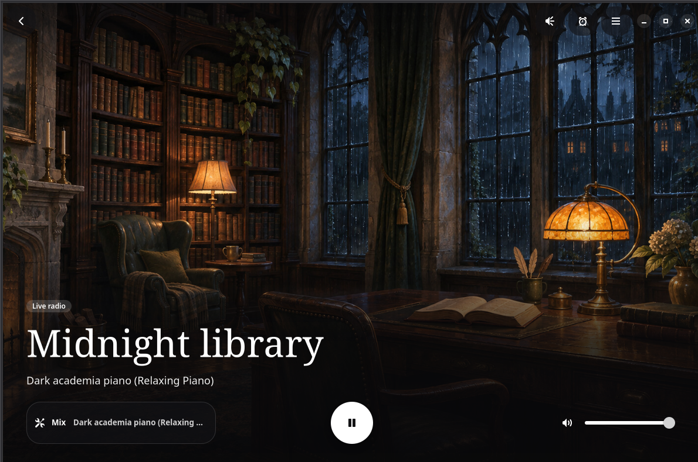
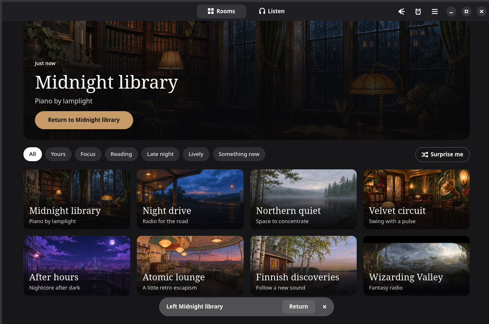
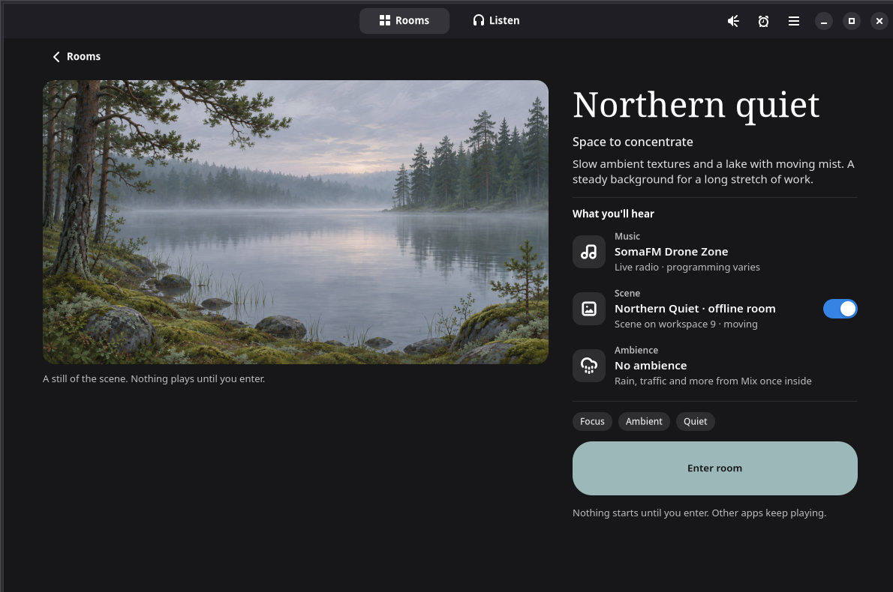
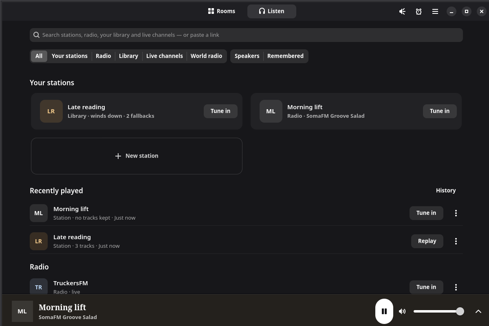
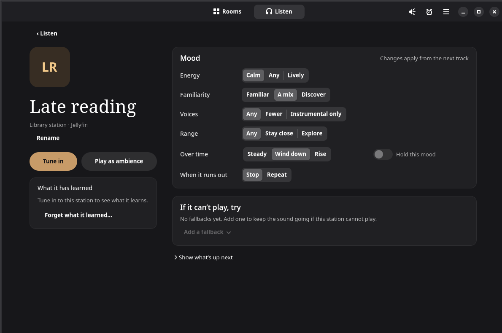
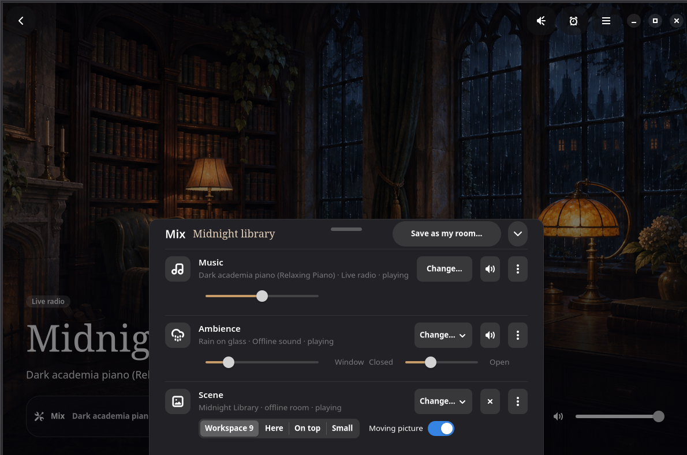
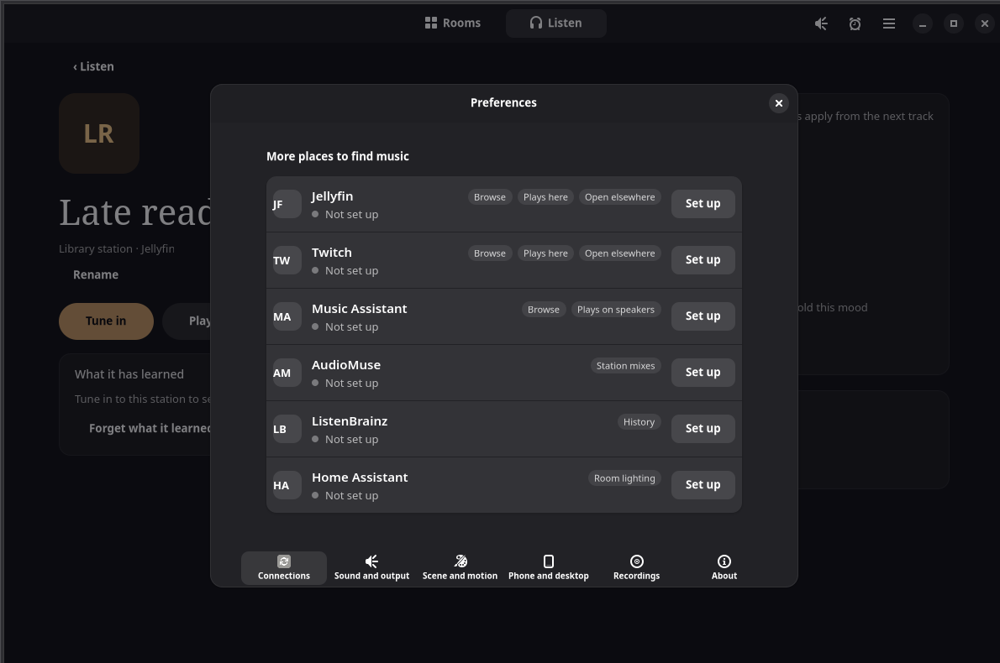
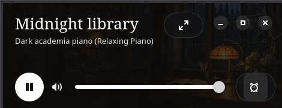
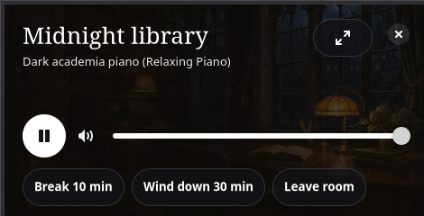
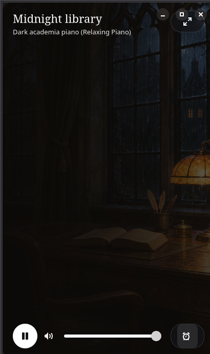

# Listening Room



**A quiet room for the radio and sounds you keep on.** Pick a room, press
Enter, and settle in. Nothing plays until you say so.

Listening Room is a small GTK4 / libadwaita app for Linux desktops. It
gathers internet radio, your music library and long ambient sounds into
eight rooms, each with its own art, a slow muted scene loop and a sound bed.
It keeps one session behind the window, so the mini player, a Waybar module,
media keys (MPRIS) and the command line all agree.

<p align="center"></p>

## A short tour

**Rooms.** Choose a room by mood. Previewing is silent; Enter room is the only
thing that starts sound.





**Listen.** Search first. Radio, library albums, pasted links and live channels
sit on shelves; selecting one is inert, Tune in is the action.





**Now.** The room's scene, what is playing, the room volume and a timer. The
Mix sheet blends music, the room's sound bed and an optional layer.



**Preferences.** Connections, sound and output, scene and motion, phone and desktop, and recordings, in the same window.



**Glance.** A mini player for a corner of the screen, and a popover for Waybar.

<p>


</p>

The window adapts down to narrow widths:



## The eight rooms

| | | |
|---|---|---|
| <br>Midnight library | <br>Night drive | <br>Northern quiet |
| <br>Velvet circuit | <br>After hours | <br>Atomic lounge |
| <br>Finnish discoveries | <br>Wizarding Valley | |

The room art and scene inputs are **AI-generated** and released under
[CC0-1.0](LICENSES/CC0-1.0.txt); the prompts are in `src/artwork/`.

## Quick start

You need Nix with flakes, on x86_64 Linux. Try it without installing:

```sh
nix run github:bayleafwalker/listening-room            # the Listening Room window
nix run github:bayleafwalker/listening-room -- --mini  # the mini player
nix run github:bayleafwalker/listening-room#listening-hub -- doctor   # the command-line tools
```

The first build renders the scene loops and runs the test suites, so it takes a
few minutes; later runs are cached. The package also provides `listening-hub`
(the command-line menu and controls), `listening-session` (the session service),
`listening-roomctl` and `listening-session-client`. `nix run` starts the app
directly; for the Waybar module and media keys the session service should run
as a user service (below).

### NixOS or Home Manager

Add the flake as an input and use its overlay:

```nix
{
  inputs.listening-room.url = "github:bayleafwalker/listening-room";
  inputs.listening-room.inputs.nixpkgs.follows = "nixpkgs";
  # ...
  nixpkgs.overlays = [ inputs.listening-room.overlays.default ];
}
```

Then, in a Home Manager module:

```nix
let
  hub = pkgs.listening-hub.override {
    # Optional: prefill your Jellyfin server in the packaged Feishin launcher.
    # jellyfinUrl = "https://jellyfin.example.org";
    # jellyfinName = "My music";
  };
in {
  home.packages = [ hub ];
  systemd.user.services.listening-session = {
    Unit = {
      Description = "Listening Room session";
      PartOf = [ "graphical-session.target" ];
      After = [ "graphical-session.target" ];
    };
    Service = { ExecStart = "${hub}/bin/listening-session"; Restart = "on-failure"; UMask = "0077"; };
    Install.WantedBy = [ "graphical-session.target" ];
  };
  # Waybar custom module:
  programs.waybar.settings.mainBar."custom/listening" = {
    exec = "${hub}/bin/listening-roomctl status";
    return-type = "json";
    interval = 1;
    on-click = "${hub}/bin/listening-roomctl popover";
    on-click-right = "${hub}/bin/listening-room";
    on-scroll-up = "${hub}/bin/listening-roomctl volume +5";
    on-scroll-down = "${hub}/bin/listening-roomctl volume -5";
    escape = false;
  };
}
```

The package uses the application ids `app.kotona.ListeningRoom` and
`app.kotona.ListeningPopover` (a window rule can match on them).

## Requirements

GTK4, libadwaita, PyGObject, mpv, ffmpeg and yt-dlp, with `playerctl`,
`pulseaudio` tools and WirePlumber for desktop player and device control. GStreamer
plays the scene loops (without it a room shows still art). The Nix package brings
all of these. Optional: Hyprland (a Wayland compositor with its own workspace
commands), Waybar, rofi (for the command-line menu), Feishin, flatpak.

## Optional providers

Everything works without an account. Each provider adds a little:

| Provider | What it adds |
|---|---|
| Radio Browser, laut.fm, SomaFM, Yle | Radio stations in Listen, direct streams |
| YouTube Music | Discovery links and audio from pasted links (through yt-dlp) |
| Jellyfin | Your albums and playlists on a Library shelf, track details |
| Music Assistant | Play on your speakers; room output follows |
| AudioMuse | Station mixes from your library's own sound |
| Home Assistant | Room lighting that follows the room |
| ListenBrainz | Listening history and recommendations, if you connect it |
| Twitch | Live channel layers (Music and ASMR) and a review of channels you follow |
| MusicBrainz / Chromaprint | Recording metadata and optional review of tracks |
| Voice/instrumental models (MTG) | Optional estimates of voice vs instrumental; weights are CC BY-NC-SA 4.0 |

Set them up under Menu > Preferences > Connections (all start as "Not set up"). See
[`docs/runbooks/`](docs/runbooks) for each one.

## Keyboard

| Keys | Action |
|---|---|
| Space | Pause or resume the room |
| Ctrl+1, Ctrl+2, Ctrl+3 | Rooms, Listen, Now |
| Ctrl+F | Search (or just start typing) |
| Ctrl+L, Ctrl+V | Add a link |
| Ctrl+M | Mini player |
| Ctrl+, | Preferences |
| Up, Down | Room volume in Now |
| Esc | Close a sheet, then go back to browsing |
| Ctrl+? | Show all shortcuts |

## Privacy

- **Nothing autoplays.** Launching, browsing, searching and previewing never
  start sound. Entering a room or choosing Tune in does. A test enforces it.
- **Secrets stay private.** Provider tokens are kept in files only you can read
  (mode 600) and are not shown in the window.
- **No telemetry.** The app talks only to services you use (stations, your
  servers, the providers you connect) and never to its authors.
- Your listening state lives in `~/.local/state/listening-hub/`. Delete it to
  start over.

## Develop

```sh
scripts/listening-dev.sh test               # all test suites, isolated state, ~1 minute
scripts/listening-dev.sh probe [OUTDIR]     # real GTK on a private Xvfb + D-Bus
scripts/listening-dev.sh shell              # the dev shell
nix build                                   # the full package and its checks
scripts/showcase.sh                         # regenerate the images in this README
```

See [CONTRIBUTING.md](CONTRIBUTING.md).

## FAQ

**I do not use Hyprland or Waybar.** Neither is needed. `listening-room` is a
normal GTK window and works on GNOME, KDE and other compositors. Waybar is only
for the optional bar module; media keys use MPRIS, so they work anywhere. Only
the window-placement actions that use Hyprland commands are skipped elsewhere.

**I do not use Jellyfin.** Skip it. Radio, links, rooms and layers work without
any account. If you do use it, connect it under Preferences > Connections, or
build with `jellyfinUrl` to prefill the Feishin launcher.

**A station will not load.** Choose another, or open its website from the
station page. A failed load never opens a browser by itself. `listening-hub
doctor` lists the tools it found.

**The scenes are still pictures.** GStreamer's plugins were not found, or
reduced motion is on (Preferences > Motion).

**Can I use the art?** Yes, it is CC0 and AI-generated; see
[`LICENSES/CC0-1.0.txt`](LICENSES/CC0-1.0.txt).

## License

The code is GPL-3.0-or-later ([LICENSE](LICENSE)). The room art and scene
inputs (`src/artwork/`, `src/scene_tuning/`) are CC0-1.0, AI-generated. The
optional MTG model weights fetched at build time are CC BY-NC-SA 4.0 and
separately attributed in [`src/models/README.md`](src/models/README.md).
